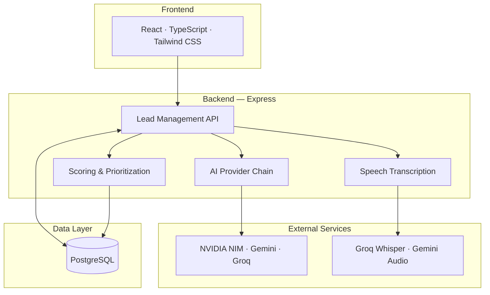

# LeadLens: AI-Powered Real Estate Sales Copilot

**AI-powered lead qualification, intelligent prioritization, and sales follow-up automation for Indian real estate teams.**

LeadLens helps sales teams turn enquiries into structured lead profiles, understand which prospects need attention, and take the next step with confidence.

<p align="center">

  **Capture → Analyze → Prioritize → Follow up**

</p>

## What it does

| Feature | What you can do |
|---|---|
| **Lead capture** | Add leads using a form, pasted text, or audio recording/upload |
| **AI lead analysis** | Extract budget, location, requirements, timeline, and buying intent |
| **Explainable scoring** | See why a lead is rated Hot, Warm, or Cold |
| **Today's Queue** | Focus on leads that need attention |
| **Call preparation** | Get suggested opening lines, questions, and likely objections |
| **Call debrief** | Record outcomes, commitments, and next steps |
| **Follow-up tools** | Open WhatsApp with a prefilled message |
| **Site visits** | Create a Google Calendar link and downloadable `.ics` invite |
| **Lead chat** | Ask questions grounded in a selected lead's saved information |

## How it works

1. **Capture** a customer enquiry.
2. **Review** the transcript and extracted details.
3. **Analyze** intent, urgency, budget realism, and requirement clarity.
4. **Prioritize** the lead in the queue.
5. **Prepare and debrief** calls, then follow up or schedule a site visit.

## Lead scoring

The AI helps interpret the enquiry; the server calculates the final score using fixed weights.

| Signal | Weight |
|---|---:|
| Buying intent | 35% |
| Timeline urgency | 30% |
| Budget realism | 20% |
| Requirement fit and clarity | 15% |

- 🔴 **Hot:** 70–100
- 🟠 **Warm:** 40–69
- 🔵 **Cold:** 0–39

*These are heuristic weights, not a model trained on historical sales conversions.*

## Built with

**Frontend:** React 19 · TypeScript · Vite · Tailwind CSS 4

**Backend:** Node.js · Express · TypeScript · PostgreSQL · Zod

**AI & speech:** NVIDIA NIM · Google Gemini · Groq · Groq Whisper (depending on configured keys and availability)

##  Architecture


## Architecture




## Run locally

### Requirements
- Node.js 20+
- npm
- A reachable PostgreSQL database
- At least one supported text-AI provider API key
- Groq or Gemini credentials for audio transcription

### 1. Clone and install

```bash
git clone https://github.com/Shiva-74/leadlens.git
cd leadlens
npm install
```

### 2. Configure environment

Create `.env` from the example file:

**PowerShell**
```powershell
Copy-Item .env.example .env
```

**macOS/Linux**
```bash
cp .env.example .env
```

Set the values you need:

| Variable | Purpose |
|---|---|
| `DATABASE_URL` | PostgreSQL connection string |
| `NVIDIA_API_KEY` | NVIDIA NIM provider |
| `GEMINI_API_KEY` | Gemini provider / audio fallback |
| `GROQ_API_KEY` | Groq provider / Whisper transcription |
| `PORT` | Server port (defaults to `3000`) |

Keep `.env` private. Never commit real API keys. The database must be reachable when the server starts.

### 3. Start the app

```bash
npm run dev
```

Open **http://localhost:3000**.

Load sample leads to explore the queue and lead workflows. Check server/database status at **http://localhost:3000/api/health**.

### Production build

```bash
npm run build
npm start
```

## Project status

**Core application and lead-management workflows are implemented in the codebase; end-to-end validation depends on your local database and provider configuration.**

Not implemented yet:

- Automated telephony / voice-platform webhook ingestion
- Speaker diarization to separate customer and salesperson speech
- Live property-inventory matching
- Production authentication, role-based access, and external CRM sync
- Automated test suite

## Notes on reliability and privacy

- Transcripts and lead records are stored in PostgreSQL.
- Audio uploads are processed in memory for transcription and are not intentionally written to application disk.
- Review transcripts before analysis; noisy or mixed-language audio may be inaccurate.
- Anonymous sessions are intended for a demo, not production access control.
- AI provider availability and rate limits can affect requests.

## Roadmap

- Connect telephony or voice-agent platforms through webhooks
- Add speaker diarization
- Match prospects to live property inventory
- Add production authentication, automated tests, and deployment-grade rate limiting
- Integrate with external CRMs

## Contributing

Issues and pull requests are welcome. For substantial changes, open an issue to discuss the proposal first.

## License

No license has been specified yet. Until one is added, reuse is not automatically granted.

---

<p align="center">Built to help real-estate teams turn enquiries into meaningful next steps.</p>
